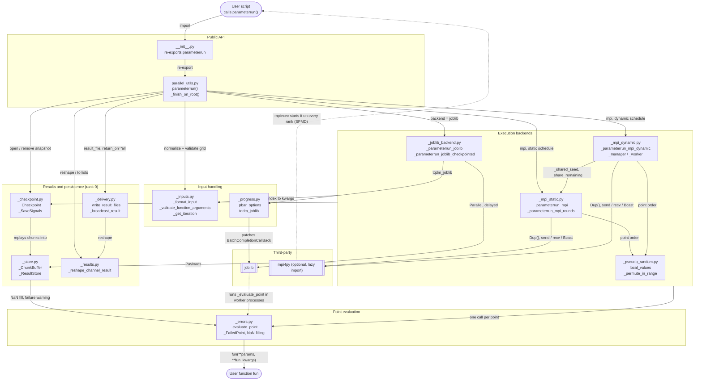
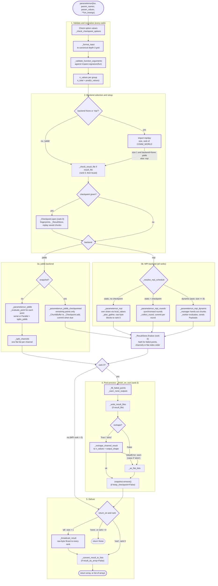

# Architecture of `parameterrun`

> **Keep this in sync:** when the package logic changes (modules, imports between them, the pipeline in
> `parameterrun()`, backend or schedule selection, checkpointing, post-processing), update the diagrams and tables
> below in the same change. The MPI shuffle and checkpointing are detailed in
> [checkpoints-and-shuffle.md](checkpoints-and-shuffle.md), and the CI/release pipeline in
> [github-actions.md](github-actions.md).

This document describes how the `parameterrun` package (version 0.5.0, branch `feature/checkpointing`) is built and
what happens when `parameterrun(...)` is called. It was written from the source in
[src/parameterrun/](../src/parameterrun/) and checked against runtime call traces (see
[Verification](#verification)). Docstrings and `CLAUDE.md` were used only to cross-check, never as the only source of
a claim.

## Contents

1. [Overview](#overview)
2. [Components](#components)
3. [Core data structures](#core-data-structures)
4. [Architecture diagram](#architecture-diagram)
5. [Execution flow](#execution-flow)
6. [Execution flowchart](#execution-flowchart)
7. [Verification](#verification)

## Overview

`parameterrun` evaluates a user function `fun` on every point of a parameter grid and returns the outputs as numpy
arrays shaped like the grid. There is a single public entry point, `parameterrun()`. Everything else is private
(underscore-prefixed modules and functions).

The call runs in four stages:

1. **Normalize and validate.** The three accepted input styles are converted to one canonical form, and the parameter
   names are checked against `fun`'s signature.
2. **Pick a backend.** joblib runs on one machine; mpi4py runs across MPI ranks with one of two schedules (static or
   dynamic). Either backend can save checkpoints.
3. **Execute.** Each grid point is identified by a *flat index* (row-major `itertools.product` order). The backends
   only differ in how they distribute those indices and collect the outputs.
4. **Post-process and deliver** on rank 0: failed points become NaN, results are reshaped to the grid, optionally
   written to `.npy` files, and returned (to rank 0, every rank, or nobody).

Runtime dependencies are `numpy`, `joblib` and `tqdm`. `mpi4py` is optional: it is imported lazily inside functions,
never at module import time.

## Components

All modules live in [src/parameterrun/](../src/parameterrun/). The imports form a DAG (no cycles); the table runs
roughly from the entry point down to the leaves.

| Group | File | Key functions / classes | Responsibility |
| --- | --- | --- | --- |
| Public API | [\_\_init\_\_.py](../src/parameterrun/__init__.py) | `__version__`, re-export of `parameterrun` | Package entry point |
| Public API | [parallel_utils.py](../src/parameterrun/parallel_utils.py) | `parameterrun`, `_finish_on_root`, `_resolve_mpi_schedule` | Option checks, backend selection, dispatch, post-processing, delivery |
| Input handling | [_inputs.py](../src/parameterrun/_inputs.py) | `_format_input`, `_validate_function_arguments`, `_product_element_from_index`, `_get_iteration`, `_params_at` | Canonical grid form; flat index → grid index → `{name: value}` |
| Input handling | [_progress.py](../src/parameterrun/_progress.py) | `_resolve_pbar_bool`, `_pbar_options`, `_LineStream`, `tqdm_joblib` | tqdm settings for terminals, notebooks, log files and MPI launchers; patches joblib's batch callback |
| Input handling | [_utils.py](../src/parameterrun/_utils.py) | `_log`, `_callable_name`, `_normalized_time`, `_mpi_world_size_from_env` | Small shared helpers (used almost everywhere; left out of the diagrams) |
| Backends | [_joblib_backend.py](../src/parameterrun/_joblib_backend.py) | `_parameterrun_joblib`, `_parameterrun_joblib_checkpointed` | Local execution: a serial loop, or a joblib `Parallel` pool |
| Backends | [_mpi_static.py](../src/parameterrun/_mpi_static.py) | `_parameterrun_mpi`, `_plan_gather`, `_send_rows`/`_recv_rows`, `_parameterrun_mpi_rounds`, `_collect_round`, `_shared_seed`, `_share_remaining` | Static MPI schedule: every rank computes a fixed pseudo-random share, then everything is gathered at the end (or once per round when checkpointing) |
| Backends | [_mpi_dynamic.py](../src/parameterrun/_mpi_dynamic.py) | `_parameterrun_mpi_dynamic`, `_manager`, `_worker`, `_guided_chunk_size` | Dynamic MPI schedule: rank 0 hands out chunks on demand, ranks ≥ 1 compute |
| Backends | [_pseudo_random.py](../src/parameterrun/_pseudo_random.py) | `local_values`, `_permute_in_range`, `_feistel_pow2` | Lazy Feistel permutation of the flat indices, for load balancing across ranks |
| Evaluation | [_errors.py](../src/parameterrun/_errors.py) | `_evaluate_point`, `_FailedPoint`, `_split_channels`, `_fill_failed_points`, `_nan_like`, `_abort_on_error` | Wraps every call to `fun`; handles `on_error="raise"` and `on_error="nan"`; aborts the MPI job on errors |
| Results | [_store.py](../src/parameterrun/_store.py) | `_ChunkBuffer`, `_ResultStore`, `_stack_channel`, `_channel_spec` | Per-worker buffers of results; rank 0's preallocated per-channel arrays (optionally memory-mapped `.npy`) with a `done` mask |
| Results | [_checkpoint.py](../src/parameterrun/_checkpoint.py) | `_Checkpoint` (`open`, `add`, `due`, `commit`, `remaining`, `remove`), `_SaveSignals`, `_run_fingerprint`, `_code_fingerprint` | Snapshot directory (`manifest.json` + `chunk_*.npz`), resume by replaying chunks, SIGUSR1/SIGTERM handling |
| Results | [_results.py](../src/parameterrun/_results.py) | `_reshape_channel_result`, `_warn_none_outputs`, `_as_flat_lists`, `_convert_result_to_lists` | Rank-0 reshaping and conversion |
| Results | [_delivery.py](../src/parameterrun/_delivery.py) | `_check_result_file`, `_write_result_files`, `_broadcast_result` | `.npy` output files; raw-byte broadcast for `return_on="all"` |

## Core data structures

These types connect the modules. Knowing them makes both diagrams easier to read.

| Name | Defined in | Shape | Used for |
| --- | --- | --- | --- |
| Canonical grid | `_format_input` | `param_names: list[list[str]]`, `param_values: list[list[list[Any]]]` | Each outer entry is one *group*, i.e. one grid axis. Parameters within a group vary together. |
| Flat index | everywhere | `int` in `[0, n_total)`, with `n_total = prod(n_values)` | Identifies a point in row-major order. `_product_element_from_index` maps it to the grid index, and `_get_iteration` maps that to the kwargs. |
| `_FailedPoint` | `_errors.py` | frozen dataclass `(summary, traceback)` | Placeholder returned by `_evaluate_point` for a failure under `on_error="nan"`. Later replaced by NaN. |
| Channel | `_store.py` | `np.ndarray` of shape `(n_total, *output_shape)`, or a flat `list` | One output of `fun`. A tuple return means several channels. |
| `Payload` | `_store.py` | `(indices: int64 array, channels: list[Channel], failures: list[(index, _FailedPoint)])` | A block of results. Produced by `_ChunkBuffer.payload()`, consumed by `_ResultStore.write` and `_Checkpoint.add`, and sent over MPI. |
| `ChannelSpec` | `_store.py` | `("array", output_shape, dtype_str)` or `("list",)` | How rank 0 allocates a channel. |

Every backend returns `(channels, n_outputs)`, where the channels are in flat-index order. That shared contract is
what lets `_finish_on_root` treat all backends the same way.

## Architecture diagram

The arrows are module dependencies, labelled with what flows along them.

- **Solid arrow:** confirmed in the source (an `import`, or a call or argument visible in the code).
- **Dotted arrow:** inferred. It describes the behaviour of an external library or the runtime environment, which
  this package's code does not show directly.

To keep the diagram readable:

- `_utils.py` and `numpy` are used by nearly every module, so they are left out.
- An arrow that starts at the **Execution backends** box stands for the same import in all three backend modules.
- Some minor imports are omitted: `parallel_utils.py` → `_progress.py` (progress-bar mode), `parallel_utils.py` →
  `_errors.py` (`_fill_failed_points`), `parallel_utils.py` → mpi4py (rank and size), `_delivery.py` → `_store.py`
  (`_channel_paths`), and the backends → tqdm.
- The user's script, which calls `parameterrun()`, and the user's function `fun`, which `_evaluate_point` calls, are
  drawn as two separate nodes.

## Execution flow

### 1. Validation and normalization (every rank)

[parallel_utils.py](../src/parameterrun/parallel_utils.py) `parameterrun()`:

- Checks the option values: `reshape`, `on_error`, `mpi_schedule`, `mpi_chunk_size`, `return_on`, the `result_file`
  suffix, and `_check_checkpoint_options`.
- `_format_input` turns any of the three input styles (a single name; a list of names; a list of name groups) into the
  canonical depth-3 form. It also rejects empty names, duplicates, and groups whose parameters have different lengths.
- `_validate_function_arguments` compares the swept names and `fun_kwargs` with `inspect.signature(fun)`. The check
  for unknown names is skipped when `fun` accepts `**kwargs`.
- `n_values` is computed from the groups (`len(group[0])`). An empty group raises.

### 2. Backend selection

- If `backend` is `None` or `"mpi"`, the function tries `from mpi4py import MPI` and reads `COMM_WORLD`'s size and
  rank.
  - `backend=None` with size 1, or without mpi4py: **joblib**.
  - Otherwise: **mpi**.
  - `backend="mpi"` without mpi4py raises `ImportError`.
- `backend="joblib"` with `n_workers < 0` inside an MPI job warns about oversubscription. The job is detected through
  launcher environment variables (`_mpi_world_size_from_env`).
- `result_file`: rank 0 runs `_check_result_file`, and the outcome is broadcast so that every rank raises together.
- `checkpoint`: rank 0 calls `_Checkpoint.open`, which:
  - fingerprints the run (parameter names and values, `fun_kwargs`) and the code of `fun`;
  - creates a `_ResultStore`;
  - if the directory holds a compatible snapshot, checks it, reopens memory-mapped `result_file` channels and replays
    the `chunk_*.npz` files into the store.

  Errors are broadcast so that every rank raises.

### 3a. joblib backend ([_joblib_backend.py](../src/parameterrun/_joblib_backend.py))

- **Without a checkpoint** (`_parameterrun_joblib`):
  - Iterates over `product(*indices)` and calls `_evaluate_point(fun, _get_iteration(...), fun_kwargs, on_error)` for
    each point.
  - Runs serially when `n_workers == 1`. Otherwise it uses `Parallel(n_jobs=n_workers)` inside `tqdm_joblib`, which
    temporarily swaps `joblib.parallel.BatchCompletionCallBack` to drive the bar.
  - `_split_channels` turns the per-point returns into **one flat list per output channel**. `_FailedPoint`s stay in
    the lists for now.
- **With a checkpoint** (`_parameterrun_joblib_checkpointed`):
  - Evaluates only `checkpoint.remaining()` (or every point if nothing was resumed), with
    `Parallel(return_as="generator")` or a serial generator.
  - Results go through a `_ChunkBuffer`, which is flushed into `_Checkpoint.add` (and so into the `_ResultStore`) every
    4096 points or `_MAX_MESSAGE_BYTES`.
  - `_Checkpoint.commit` runs whenever `due()` says so.
  - On any exception, including `SystemExit` from SIGTERM handling, it flushes and calls `commit_quietly` before
    re-raising.
  - Ends with `store.finalize`, which returns arrays or lists with failures already NaN-filled.

### 3b. MPI backend

`_resolve_mpi_schedule` returns `"static"` for size < 2. With `"auto"`, it returns `"dynamic"` for size ≥ 8 and
`"static"` otherwise. Each MPI function works on its own `COMM_WORLD.Dup()` and frees it on normal return.

- **Static schedule, no checkpoint** ([_mpi_static.py](../src/parameterrun/_mpi_static.py) `_parameterrun_mpi`):
  1. `_shared_seed` broadcasts rank 0's seed.
  2. Each rank lazily iterates over its share, `local_values(n_total, size, rank, seed)`, which is a Feistel
     permutation with interleaved positions, and evaluates its points into a `_ChunkBuffer`.
  3. Workers send a done signal (tag 0). Rank 0 gathers per-rank summaries, and `_plan_gather` decides for each channel
     whether it travels as `"array"` (raw bytes, in row blocks of at most `_MAX_MESSAGE_BYTES`, via
     `_send_rows`/`_recv_rows`) or as `"list"` (a pickled `gather`).
  4. If there is an error (inconsistent output counts, or every point failed), it is broadcast in the plan so that
     every rank raises.
  5. Rank 0 writes everything into a `_ResultStore` (memory-mapped if `result_file` is set) and calls `finalize`.
     Non-root ranks return `([], n_outputs)`.
  6. If `fun` raises with `on_error="raise"` and size > 1, `_abort_on_error` prints the traceback once and calls
     `comm.Abort(1)`.
- **Static schedule with a checkpoint** (`_parameterrun_mpi_rounds`):
  1. `_share_remaining` broadcasts rank 0's `done` mask, packed as bits, so the same permutation is applied to the
     *remaining* points only. This means the number of ranks can change between runs.
  2. Ranks compute in synchronised rounds. A round ends after `checkpoint_every / size` points, after
     `checkpoint_interval` seconds, or on a signal.
  3. At the end of each round, workers send their `Payload`s (tag 21) and a state message (tag 22).
     `_collect_round` on rank 0 adds them to the checkpoint and decides whether to `continue`, `stop`, `terminate`
     or report an `error`. Rank 0 commits, and the decision is broadcast.
- **Dynamic schedule** ([_mpi_dynamic.py](../src/parameterrun/_mpi_dynamic.py) `_parameterrun_mpi_dynamic`): rank 0 is
  the manager and ranks ≥ 1 are workers.
  - Each worker announces it is ready (`_TAG_RESULT` with `None`).
  - The manager answers each request with `(start, stop)` positions, sized by `_guided_chunk_size` (a quarter of each
    worker's share of what is left, or `mpi_chunk_size`), or with `_TAG_STOP` when nothing is left.
  - The worker maps each position to a flat index through `_permute_in_range` (and through `remaining` when resuming),
    evaluates the point, and sends the chunk's `Payload` back. Large chunks go early as `_TAG_PARTIAL`.
  - The manager writes each `Payload` into the `_ResultStore`, or into `_Checkpoint.add` followed by `commit` when
    `due()`.
  - Errors in `fun` go to the manager as `_TAG_ERROR`, and the manager aborts the job. Workers forward signals as
    `_TAG_SIGNAL`.
  - At the end, rank 0 broadcasts `None`, or the "all points failed" message. Workers return `([], 0)`.

### 4. Post-processing on rank 0 (`_finish_on_root`)

1. `_fill_failed_points` replaces `_FailedPoint`s with NaN of the matching shape. This only affects flat lists, i.e. the
   uncheckpointed joblib path; `_ResultStore.finalize` has already done it for every store-based path.
2. `_warn_none_outputs` warns about channels that contain `None`.
3. If `result_file` is set, `_write_result_files` saves each channel reshaped to the grid. Channels that the store
   already keeps memory-mapped in that same file are skipped.
4. If `reshape` is set, `_reshape_channel_result` reshapes each channel to `n_values + output_shape`. If that fails, it
   warns and falls back to flat lists, or raises when `reshape="strict"`. With `reshape=False`, `_as_flat_lists`
   produces the flat lists.
5. If the run succeeded and `keep_checkpoint=False`, `snapshot.remove()` deletes the snapshot.

### 5. Delivery

- `return_on="all"` with size > 1: `_broadcast_result` sends the layout first, then the numeric arrays as raw-byte
  `Bcast` blocks. Anything else is pickled. If rank 0 failed in `_finish_on_root`, the other ranks raise a
  `RuntimeError` instead of hanging.
- Non-root ranks (without `"all"`) and `return_on="none"` return `None`.
- `result_as_array=False` converts the result to nested lists with `_convert_result_to_lists`.

## Execution flowchart

This chart follows the full call, using the default local case (joblib) as the main path. The MPI branch is
summarised at module level.

- **Thick border:** step observed in a runtime trace (see [Verification](#verification)).
- **Thin border:** confirmed by reading the source only; this configuration was not traced.

No step in this chart is inferred: every box and arrow corresponds to code in `parallel_utils.py` or the backend
modules.

## Verification

### Method

1. **Static reading.** Every module in `src/parameterrun/` was read in full, and all `import` statements were listed
   with `grep`, including the function-local `from mpi4py import MPI` imports. Each solid arrow in the architecture
   diagram corresponds to an import or a call seen in the code.
2. **Runtime traces.** A throwaway script (outside the repository) installed `sys.setprofile` and recorded every
   `parameterrun` function in the order of its first call. It used a two-parameter grid and a function returning two
   outputs (a scalar and an array), and ran these configurations:

   | Configuration | How it was run | Path observed |
   | --- | --- | --- |
   | joblib, `n_workers=1` | in-process | `parameterrun → _format_input → _validate_function_arguments → _parameterrun_joblib → _get_iteration → _evaluate_point → _split_channels → _finish_on_root → _fill_failed_points → _warn_none_outputs → _reshape_channel_result` |
   | joblib + `checkpoint` | in-process | `… → _Checkpoint.open → _run_fingerprint / _code_fingerprint → _ResultStore.__init__ → … → _parameterrun_joblib_checkpointed → _Checkpoint.remaining → _ChunkBuffer.add → _Checkpoint.due → _Checkpoint.add → _ResultStore.write/allocate → _Checkpoint.commit → _write_chunk → _ResultStore.finalize → _finish_on_root …` |
   | MPI static (`auto` with 2 ranks) | `mpiexec -n 2` (MS-MPI), rank 0 | `… → _resolve_mpi_schedule → _parameterrun_mpi → _shared_seed → local_values → _permute_in_range → _evaluate_point → _ChunkBuffer.add/payload → _plan_gather → _ResultStore.allocate → _recv_rows → _ResultStore.finalize → _finish_on_root …` |
   | MPI static + `checkpoint` | `mpiexec -n 2`, rank 0 | `… → _Checkpoint.open → … → _parameterrun_mpi_rounds → _shared_seed → _share_remaining → _SaveSignals.__enter__ → local_values → _evaluate_point → _collect_round → _Checkpoint.add → _Checkpoint.commit → _ResultStore.finalize → _finish_on_root …` |
   | MPI dynamic, `return_on="all"` | `mpiexec -n 2`, rank 0 (manager) | `… → _parameterrun_mpi_dynamic → _shared_seed → _share_remaining → _ResultStore.__init__ → _manager → _guided_chunk_size → _ResultStore.write → _ResultStore.finalize → _finish_on_root → … → _broadcast_result → _broadcast_item` |

### Confirmed relationships

- Every module dependency in the architecture diagram, from import statements and call sites.
- The dispatch logic in `parameterrun()`: backend auto-selection, `_resolve_mpi_schedule` (dynamic from 8 ranks on with
  `"auto"`, static below 2 ranks), and the choice between `_parameterrun_mpi_rounds` and `_parameterrun_mpi` depending
  on whether a checkpoint is given. This comes from the source and from the traces above.
- All store-based paths (checkpointed joblib, every MPI path) end in `_ResultStore.finalize`. Only the uncheckpointed
  joblib path returns flat lists that still contain `_FailedPoint`s for `_fill_failed_points`. Source and traces.
- `_checkpoint.py` imports `joblib` only for `joblib.hash` in `_value_digest`, i.e. for fingerprinting
  `param_values`/`fun_kwargs`, not for execution.
- `_mpi_dynamic.py` reuses `_shared_seed` and `_share_remaining` from `_mpi_static.py`. The MPI backends import only
  `_SaveSignals` from `_checkpoint.py`; the `_Checkpoint` object is passed in as an argument, on rank 0 only.

### Not traced (confirmed by source reading only)

- The parallel joblib path (`n_workers != 1`): the work happens in worker processes, which the in-process profiler
  cannot see. `tqdm_joblib`'s monkeypatch was confirmed by reading the code.
- MPI worker-side code (`_worker`, `_send_rows`, round messages from ranks > 0): only rank 0's trace was printed.
- `_write_result_files`, `_as_flat_lists`, `snapshot.remove()`, `_convert_result_to_lists`, resuming from an existing
  snapshot, signal handling, and the abort paths. These are thin-bordered in the flowchart.

### Inferred (not verifiable from this package's code)

- joblib's default (loky) backend running the `delayed(_evaluate_point)` calls in separate worker processes, which
  requires `fun` and its arguments to be picklable. This is joblib behaviour, shown dotted in the architecture
  diagram.
- The SPMD model: `mpiexec` starts the user's script on every rank, and every rank calls `parameterrun()`. The code
  relies on this, since it uses collective operations (`bcast`, `gather`) from every rank, but it cannot enforce it.
  Shown dotted.
- When SIGUSR1 and SIGTERM are delivered (for example by Slurm before the walltime limit). The handlers are in
  `_SaveSignals`; the timing comes from docstrings.

### Observations from cross-checking code against documentation

- The `result_file` docstring says that "under joblib, the files are written at the end". That holds only without a
  checkpoint. With a checkpoint, `_Checkpoint.open` builds the `_ResultStore` with `result_file`, so the joblib run
  also writes numeric channels into memory-mapped `.npy` files while points arrive (`_ResultStore._new_array` →
  `open_memmap`). `_write_result_files` then skips those channels.
- `CLAUDE.md` lists `_ChunkBuffer` under `_mpi_dynamic.py`. It is defined in `_store.py`, and `_mpi_dynamic.py`
  imports it.
- When `fun` raises with `on_error="raise"`, the two MPI schedules abort differently. The static schedules call
  `_abort_on_error` on the failing rank. In the dynamic schedule, the worker sends the traceback to the manager
  (`_TAG_ERROR`), and the manager calls `_print_and_abort`.
