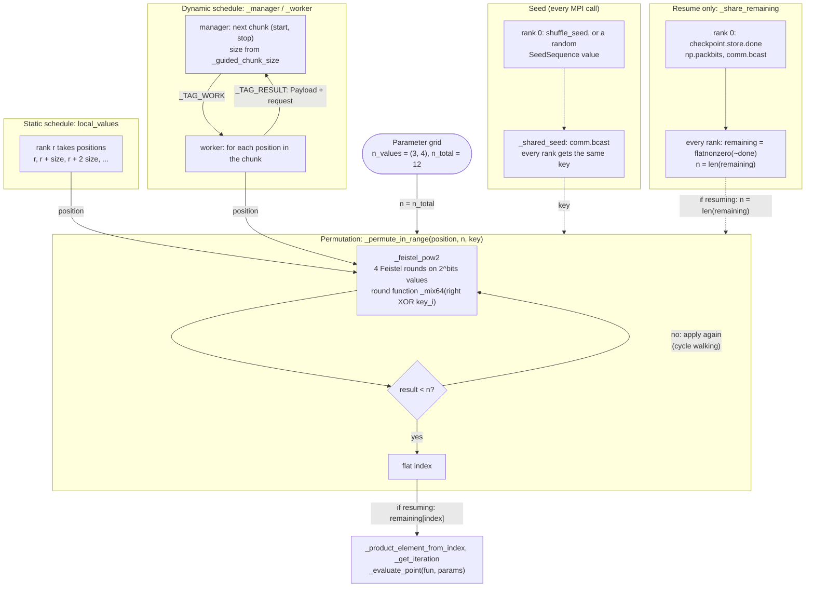
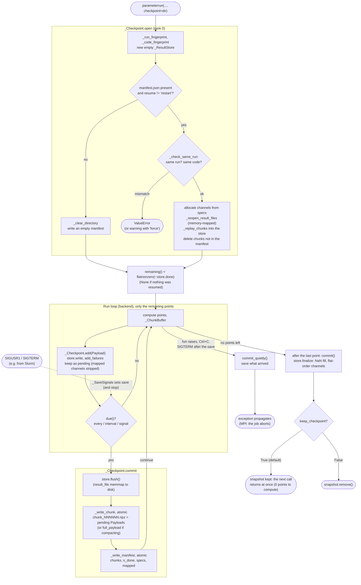
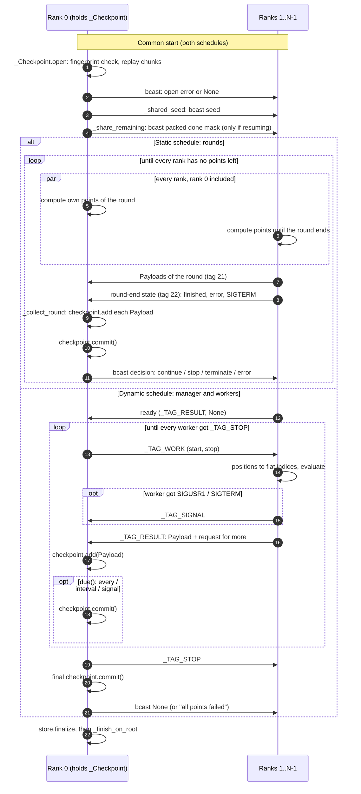

# Checkpoints and the MPI shuffle

> **Keep this in sync:** when the point distribution ([_pseudo_random.py](../src/parameterrun/_pseudo_random.py),
> `_shared_seed`, `_share_remaining`, `_guided_chunk_size`) or checkpointing
> ([_checkpoint.py](../src/parameterrun/_checkpoint.py) and its callers in the backends) changes, update the diagrams
> and tables below in the same change. The overall package structure is in [architecture.md](architecture.md).

This page explains two mechanisms that work together under MPI:

1. **The shuffle:** how the grid points are spread over the ranks, without a central task list.
2. **Checkpoints:** how finished points are saved, and how a later call resumes from them.

They meet in one place. A checkpoint records *which flat indices are done*, not a position in the shuffle. On resume,
the shuffle is applied again to the points that are left, so a run can be resumed with another backend, another
schedule, another seed or another number of ranks.

All diagrams use the same conventions as the other pages. A solid arrow is confirmed in the source. A dotted arrow is
inferred, or describes something outside this package (e.g. Slurm sending signals).

## Contents

1. [The shuffle](#1-the-shuffle)
2. [Checkpoints](#2-checkpoints)
3. [Checkpoints under MPI](#3-checkpoints-under-mpi)
4. [Verification](#verification)

## 1. The shuffle

Every grid point has a **flat index** `0 … n_total − 1`, in row-major order (`itertools.product`).
`_product_element_from_index` turns it into a grid index, and `_get_iteration` turns that into the kwargs for `fun`.

The shuffle is a **pseudo-random permutation** of the flat indices, `position → flat index`, computed one value at a
time by `_permute_in_range(position, n, seed)`. Nothing is ever materialized, so a grid of 10⁹ points costs no memory.
How it works:

- It is a 4-round **Feistel network** (`_feistel_pow2`, with `_mix64` as the round function) on `[0, 2^bits)`, where
  `bits` is the bit length of `n − 1`, rounded up to an even number.
- A Feistel network is a bijection on `[0, 2^bits)`. To get a bijection on `[0, n)`, **cycle walking** applies it
  again until the result is below `n`.
- The `seed` is the Feistel key. `_shared_seed` draws it on rank 0 (unless `shuffle_seed` is given) and broadcasts it,
  so every rank computes the same permutation.

Why shuffle at all: neighbouring grid points often cost about the same (e.g. a large `N` axis). Handing out the points
in grid order would give one rank all the expensive ones. Shuffling mixes cheap and expensive points on every rank.

The two schedules use the permutation differently:

- **Static** (`local_values`): rank `r` takes the positions `r, r + size, r + 2·size, …` and computes
  `_permute_in_range` for each one. Every rank knows its own share; no messages are needed until the gather at the end.
- **Dynamic**: the manager (rank 0) only hands out ranges of positions `(start, stop)`. Each worker computes
  `_permute_in_range` itself. Chunks are *guided* by `_guided_chunk_size`: `remaining // (4 · n_workers)`, at least 1,
  or a fixed `mpi_chunk_size`. Chunks start large (few messages) and shrink to one point at the end (no long tail).
- **Resume** (both schedules): `_share_remaining` broadcasts rank 0's `done` mask, packed into bits. Every rank builds
  `remaining = flatnonzero(~done)` and shuffles *positions in `remaining`*: `flat index = remaining[perm(position)]`.



The dotted arrow is drawn dotted because it is conditional (only on resume), not because it is inferred.

### Worked example

Computed with the package's own functions: grid `(3, 4)`, `n_total = 12`, seed `42`, 3 ranks, static schedule.

| Rank | Positions | Flat indices | Grid indices `(a, b)` |
| --- | --- | --- | --- |
| 0 | 0, 3, 6, 9 | 11, 8, 10, 9 | (2,3), (2,0), (2,2), (2,1) |
| 1 | 1, 4, 7, 10 | 2, 4, 3, 6 | (0,2), (1,0), (0,3), (1,2) |
| 2 | 2, 5, 8, 11 | 0, 5, 7, 1 | (0,0), (1,1), (1,3), (0,1) |

The full permutation is `[11, 2, 0, 8, 4, 5, 10, 3, 7, 9, 6, 1]`, and every index appears exactly once. On such a tiny
grid the mixing is visibly weak: rank 0 happens to get the whole row `a = 2`, since the Feistel network then works on
only 2-bit halves. Real grids are much larger.

**Resuming** the same grid with points `0–4` and `7` done, on 2 ranks: `remaining = [5, 6, 8, 9, 10, 11]`. Rank 0
computes `[6, 5, 10]` and rank 1 computes `[8, 9, 11]`.

**Dynamic chunk sizes** for 1000 points and 4 workers: `62, 58, 55, 51, 48, 45, …`, down to `1, 1, 1`. That is 89
chunks in total.

## 2. Checkpoints

A checkpoint is a **directory**, written only by rank 0 (or by the single joblib process):

```text
checkpoint_dir/
├── manifest.json        format, run + code fingerprint, list of committed chunks, n_done, specs, mapped, result_file
├── chunk_000000.npz     the Payloads of one save: flat indices, output channels, failed points
├── chunk_000001.npz
└── ...
```

Rules that make it safe against a crash at any moment:

- Every file is written **atomically** (`_write_atomic`): first `<name>.tmp`, then `fsync`, then `os.replace`. A
  reader sees either the old file or the complete new one.
- A chunk counts only once `manifest.json` lists it. The chunk is written first and the manifest second, so a crash
  in between leaves a stray chunk, which the next `open` deletes.
- **Append-only:** each save adds one chunk. The exception is *compaction*, explained below.
- Numeric outputs are stored as plain arrays and loaded with `allow_pickle=False`. Only non-numeric outputs (lists of
  Python objects) are pickled.
- With a memory-mapped `result_file`, its channels are **not copied** into chunks: `commit` flushes the file before
  writing the manifest, and resuming maps the file again. If such a channel later stops living in the file (e.g. a
  point returns another shape), the next commit writes one chunk with every finished point and deletes the older
  chunks. That is compaction.

**When to save** (`_Checkpoint.due`): after `checkpoint_every` points, after `checkpoint_interval` seconds, or on a
signal, whichever comes first. If neither option is given, it saves every 600 s. Signals are handled by
`_SaveSignals`:

- **SIGUSR1** (POSIX): save now and continue. For example, Slurm's `--signal=USR1@600` sends it 10 minutes before the
  walltime limit.
- **SIGTERM**: save now, then terminate as the signal would have (`_SaveSignals.terminate`).

**Resume checks** (`_Checkpoint.open`, `_check_same_run`):

- **Run fingerprint:** `param_names`, `n_values`, and `joblib.hash` digests of `param_values` and `fun_kwargs`. Any
  difference raises `ValueError`.
- **Code fingerprint of `fun`:** bytecode, constants, defaults, closures, and the helper functions of the same module
  that `fun` calls, plus argument bindings and execution metadata. Across Python minor versions, differing source
  proves a change; otherwise compatibility is unverifiable and resuming warns, because matching source cannot
  validate captured state or helpers. What happens on a mismatch depends on `checkpoint_resume`:
  - `"auto"` raises.
  - `"force"` warns and resumes.
  - `"restart"` discards the snapshot.



## 3. Checkpoints under MPI

Only rank 0 holds the `_Checkpoint`. The other ranks only install `_SaveSignals` and send their results (and any
signal) to rank 0. The two schedules save at different moments.

| | Static schedule + checkpoint (`_parameterrun_mpi_rounds`) | Dynamic schedule + checkpoint (`_parameterrun_mpi_dynamic`) |
| --- | --- | --- |
| Point order | `local_values` over the remaining points | positions handed out by the manager |
| When it saves | at the end of each **round**: after `ceil(checkpoint_every / size)` points per rank, or `checkpoint_interval` seconds, or a signal | whenever `due()` after a message arrives; the workers never stop |
| Cost | fast ranks wait for the slowest at every round end | none for the workers; the manager writes while they compute |
| SIGUSR1 / SIGTERM on a worker | ends the round now; reported in the round-end state | forwarded to the manager as `_TAG_SIGNAL` |
| SIGTERM outcome | rank 0 saves, broadcasts `("terminate",)`, and every rank re-raises SIGTERM | the manager saves, then `comm.Abort(1)` ends the job |
| `fun` raises (`on_error="raise"`) | rank 0 saves its own points of the round, then the job aborts | the manager saves what arrived, then aborts |



## Verification

- **Static reading:** I read [_pseudo_random.py](../src/parameterrun/_pseudo_random.py),
  [_checkpoint.py](../src/parameterrun/_checkpoint.py), [_store.py](../src/parameterrun/_store.py), the MPI backends
  and the checkpointed joblib backend in full. The steps, conditions and message tags in the diagrams are taken from
  that code.
- **Worked example:** the tables in section 1 were computed by calling `_permute_in_range`, `local_values` and
  `_guided_chunk_size` directly, with the values shown. The permutation was checked to contain every index exactly
  once.
- **Checkpoint behaviour**, checked with a joblib run (`n_workers=1`, `checkpoint_every=4`, a 3 × 4 grid) whose `fun`
  raised at the 8th point:
  - The first run saved `chunk_000000.npz` (4 points, a regular commit) and `chunk_000001.npz` (the 3 points finished
    before the exception, saved by `commit_quietly`), with `n_done = 7` in the manifest.
  - The second call computed only the 5 missing points, and the result matched the full grid.
  - A third call computed 0 points (`keep_checkpoint=True`).
  - A call with a changed `param_values` raised `ValueError: … belongs to another run: param_values differ`.
- **MPI paths:** the earlier rank-0 traces (see [architecture.md](architecture.md#verification)) confirm the calls
  `_share_remaining → … → _collect_round → _Checkpoint.add → _Checkpoint.commit` for the static schedule with a
  checkpoint, and `_manager → _guided_chunk_size → _ResultStore.write` for the dynamic schedule.
- **Not executed:**
  - signal handling (SIGUSR1 and SIGTERM, which are POSIX-only for SIGUSR1; this machine runs Windows);
  - the dynamic schedule *with* a checkpoint;
  - compaction;
  - resuming with a memory-mapped `result_file`.

  These are taken from the source only.
- **Inferred:** the Slurm behaviour (when SIGUSR1 and SIGTERM arrive) comes from docstrings and Slurm's documented
  behaviour, not from this package's code.
