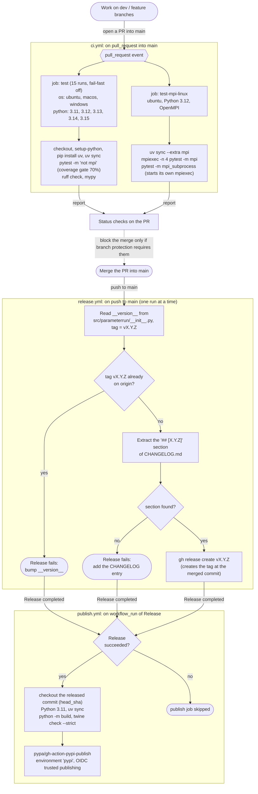

# GitHub Actions

> **Keep this in sync:** this page describes [.github/workflows/](../.github/workflows/). When a workflow changes
> (triggers, jobs, matrix, steps, conditions), update the chart and the tables below in the same change.

The repository has three workflows. They form one pipeline, from a pull request to a PyPI release:

| Workflow | File | Trigger | What it does |
| --- | --- | --- | --- |
| CI | [ci.yml](../.github/workflows/ci.yml) | `pull_request` into `main` | Tests, lint and type check on 15 OS/Python combinations, plus MPI tests on Linux |
| Release | [release.yml](../.github/workflows/release.yml) | `push` to `main` (i.e. a merged PR) | Reads `__version__`, checks that the tag is new and that `CHANGELOG.md` has a matching entry, then creates the GitHub release and tag `vX.Y.Z` |
| Publish | [publish.yml](../.github/workflows/publish.yml) | `workflow_run`: Release completed | If Release succeeded: builds the sdist and wheel, checks them, and uploads them to PyPI |

## Pipeline chart

- **Solid arrow:** confirmed in the workflow files.
- **Dotted arrow:** inferred. It depends on repository settings on GitHub (e.g. branch protection), which are not
  stored in the repository.

## Jobs in detail

### CI ([ci.yml](../.github/workflows/ci.yml))

| Job | Runs on | Steps | Notes |
| --- | --- | --- | --- |
| `test` | ubuntu, macos, windows × Python 3.11–3.15 (15 runs) | `uv sync`, `pytest -m "not mpi"`, `ruff check .`, `mypy` | `fail-fast: false`, so one failing combination does not cancel the others. `addopts` in `pyproject.toml` adds the 70% coverage gate. |
| `test-mpi-linux` | ubuntu, Python 3.12 | `mpi4py/setup-mpi` (OpenMPI), `uv sync --extra mpi`, `mpiexec -n 4 … pytest -m mpi`, then `pytest -m mpi_subprocess` | The `mpi` tests need exactly 4 ranks. The `mpi_subprocess` tests start their own `mpiexec -n 4`, so they run outside `mpiexec`. |

Permissions are read-only (`contents: read`).

### Release ([release.yml](../.github/workflows/release.yml))

Runs on every push to `main`. `concurrency: release-main` with `cancel-in-progress: false` queues runs instead of
running them in parallel. Permissions: `contents: write` (needed to create the release and tag).

1. Read `__version__` from `src/parameterrun/__init__.py` with a regex, and set `tag = v<version>`.
2. Fail if that tag already exists on `origin`.
3. Fail if `CHANGELOG.md` has no `## [<version>]` heading. Otherwise its body becomes `release_notes.md`.
4. `gh release create v<version> --target <sha>` creates the release and the tag.

### Publish ([publish.yml](../.github/workflows/publish.yml))

Starts whenever the Release workflow completes, and runs its job only if Release succeeded. It checks out the commit
Release ran on (`workflow_run.head_sha`), builds with `python -m build`, validates with `twine check --strict`, and
uploads with `pypa/gh-action-pypi-publish`. There is no API token in the workflow: it uses the `pypi` environment and
an OIDC token (`id-token: write`), i.e. PyPI trusted publishing.

## What this means in practice

- **CI only runs on pull requests into `main`.** Pushes to `dev` or feature branches are not tested by GitHub Actions.
- **Every merge into `main` is a release.** If `__version__` was not bumped, Release fails at step 2 and nothing is
  published. If the `CHANGELOG.md` section is missing, it fails at step 3. Before merging: run
  `python scripts/bump_version.py …` and move the `[Unreleased]` entries under `## [X.Y.Z] - date`.
- **Release does not wait for CI.** It runs on the push to `main`, independent of the PR checks. Whether a PR with
  failing checks can be merged at all depends on branch protection in the GitHub settings, which is not visible in
  the repository (the dotted arrow in the chart).
- **A failed Release still triggers Publish**, because `workflow_run` fires on any completion; the `if:` condition
  then skips the job.
- `uv.lock` is gitignored, so every `uv sync` in CI resolves dependencies fresh. A new upstream release can therefore
  break CI without any change in this repository.
- Plain `uv sync` also installs the `dev` dependency group, which includes `parameterrun[mpi]`. So mpi4py is installed
  in the non-MPI matrix and in Publish as well, and `--extra mpi` in the MPI job does not change anything. (uv
  installs the `dev` group by default: this is uv's documented behaviour, not something the workflow files state.)
